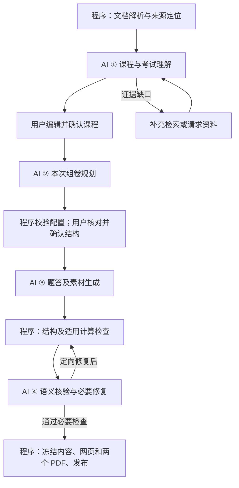

# AI 处理流程计划：四个核心环节

## 1. 总体方案

基于 [正式 PRD v1.0](PRD-v1.0.md) 和 [技术方案 v0.2](technical-design-v0.2.md)，将核心 AI 工作收敛为：

**课程与考试理解 → 本次组卷规划 → 题答及素材生成 → 语义核验与必要修复。**

采用固定工作流，由后端程序控制阶段、输入版本和执行预算。文档解析、确定性检查、计算核验、版本管理和输出交付作为配套能力。

运行上分为两条主线：

- **课程分析**：首次建立课程或材料发生变化时运行，成果经用户确认后复用。
- **每次出卷**：使用已确认课程版本，完成本次规划、生成、核验和交付。

四个环节是职责边界，实际调用次数随材料规模、题组数量和检查需求变化。

## 2. 四个核心 AI 环节

### ① 课程与考试理解

**目标：形成一份可核查、可编辑、可复用的课程依据。**

输入为解析后的教学资料、明确考试范围、试卷、答案及评分说明。处理内容包括材料分类、知识树、课程方法与深度、纳入和排除范围、考试模板、证据覆盖及冲突。

输出为统一课程草稿，保留：

- 知识要求及对应来源。
- 考试结构、难度参照和评分依据。
- 原文陈述、试卷归纳、外部补充与用户修改的区别。
- 范围内但教学证据不足的项目，以及需要澄清的冲突。

原阶段 2、3 合并到此处。材料较少时直接综合分析；材料较多时，内部按文档或语义章节分批提炼，再汇总。分批处理属于内部执行方式。

当前明确范围决定考什么，教学资料决定课程方法，历年卷帮助校准风格和复杂度。无历年卷时可以提出建议模板，并保留未校准标识。

**完成条件：**分析成果可供审阅；用户解决影响目标练习的关键问题并确认后，产生不可变课程版本。其他章节的缺口可以保留。

### ② 本次组卷规划

**目标：在生成完整题答前，确定整份练习如何组织。**

输入为已确认课程、本次模式、章节、难度、题型、大题数，以及上传题和本人本课程的未删除历史练习。

输出为组卷蓝图，包含：

- 分区、题量、分值、选答、总分及建议时长。
- 各题组的知识目标、作答要求、难度安排和计划覆盖。
- 所需课程证据、必要素材及应避开的重复题特征。

适用的原模板由程序继承；需要重新安排知识组合或调整结构时，由 AI 提出建议。程序校验硬约束，用户确认有变化的结构。配置变化后，受影响的原确认失效。

**保留原因：**整卷覆盖、综合题安排和难度分布需要统一规划，分题生成才能遵守相同目标。

### ③ 题答及素材生成

**目标：生成条件充分、能够作答、能够自行核对的新练习。**

默认按“大题或共享材料题组”生成。共享案例、数据或前置结论的题目放在同一组，独立题组可以受控并行。

每组同时形成：

- 题干、小题、条件、数据及必要图表。
- 完整解答、示例答案、评分点和适用替代答案。
- 知识要求及来源关联。

计算题包含步骤、结果、单位和精度；解释题包含理由；案例或论述题包含完整示例答案。缺少官方评分细则时，明确标为建议评分。

程序负责整卷拼装、题号及受控素材渲染。生成内容采用结构化表达，模型输出不直接作为可执行代码运行。

**完成条件：**所有题组及其答案、评分和素材齐备，进入检查。

### ④ 语义核验与必要修复

**目标：发现影响练习有效性的内容问题，并依据具体问题修复。**

采用已确认的分层核验：

| 检查层 | 覆盖及职责 |
|---|---|
| 程序结构检查 | 全量检查题号、题数、分值、选答、题答对应、素材引用和完整性 |
| 适用计算检查 | 复算、代入、单位、精度及约束关系；记录已检查和未覆盖项目 |
| AI 语义核验 | 核查全部题组的范围、方法、条件、答案、评分、难度及实质重复 |
| 按需独立求解 | 对程序不能充分覆盖的复杂计算、可解性疑点或检查冲突，先不提供生成答案，独立求解后比较 |

实质重复结合条件组织、作答要求和解题路径判断；相同知识点再次出现可以接受。

发现问题后，只修复受影响题组及其依赖内容，再执行相关检查和整卷结构检查。基线默认最多一轮内容修复；仍有未解决的关键问题则失败，保留配置和诊断结果。

**完成条件：**必要检查通过，未检查或无法判断的项目如实记录，并按冻结后的质量标准处理。

## 3. 配套程序能力与异常边界

**解析与证据管理：**保留材料版本、稳定来源位置、公式、表格和图像的必要语义；复杂视觉内容按需调用视觉模型。解析问题按目标影响处理，可完成章节继续使用。

**确认与版本管理：**课程草稿保留人工修改；课程确认和本次结构确认分别管理。生成提交后固定课程、材料、蓝图、证据及历史参考，运行过程中使用该快照。

**条件补充：**仅围绕具体缺口检索，记录原因、来源和用途。外部资料不能替代明确考试范围或覆盖课程约定。生成时发现必须改变课程依据的问题，进入 `needs_info`，补充并确认后使用新快照恢复。

**交付：**内容通过检查后由程序冻结，同一内容版本生成网页和两个 PDF。两个文件齐备才完整成功；PDF 失败只恢复导出。

**任务恢复：**沿用技术方案的幂等、取消、关联重试和唯一发布机制。检查失败、证据不足、服务失败分别记录，取消后的晚到结果不得发布。

## 4. 如何保持流程简化和高效

- **复用课程分析。** 每次出卷直接读取已确认成果；材料变化时重新处理变化内容及受影响结论。
- **控制输入规模。** 课程摘要用于组织任务，相关原始证据用于支撑生成和核查，保留必要上下文及完整表格、公式。
- **复用处理成果。** 缓存未变化的解析、材料提炼和已保存蓝图，避免重复点击或无关编辑触发完整重跑。
- **按依赖安排并行。** 独立题组并行，共享条件的题目一起处理。
- **依据问题定向修复。** 使用明确错误、计算结果和来源证据反馈，控制修复范围和次数。
- **程序负责确定性工作。** 分值汇总、状态推进、版本绑定、渲染和发布由程序执行。

该方案作为首版基线。是否还能减少调用、调整生成颗粒度，通过真实材料的质量、耗时和成本比较决定。

## 5. 验证计划与本轮边界

验证分三部分：

1. **流程与异常测试**：缺范围、无历年卷、局部解析失败、来源冲突、部分章节可练习、人工修改保留，以及取消和 PDF 恢复。
2. **核验能力测试**：植入缺条件、错计算、超纲、错分值、答案错配和仅换数字的重复题，检查漏检、误阻断及修复效果。
3. **质量和效率评测**：使用相同任务比较整卷生成与按题组生成，记录调用量、成本、修复率及完整耗时；按 PRD 执行三门课程、18 个固定任务、每任务三次的正式评测。

课程分析与完整生成分别按 **小于 120 秒**的目标统计，包含排队、重试、检查及必要导出。保留全部尝试及结果分布。

本轮确定流程、职责、交接成果和默认修复策略。模型、解析工具、检索实现、并发及运行预算进入下一轮选型和实测；质量阈值按 PRD 在基线后冻结。离线评测独立运行，用于版本验收。
