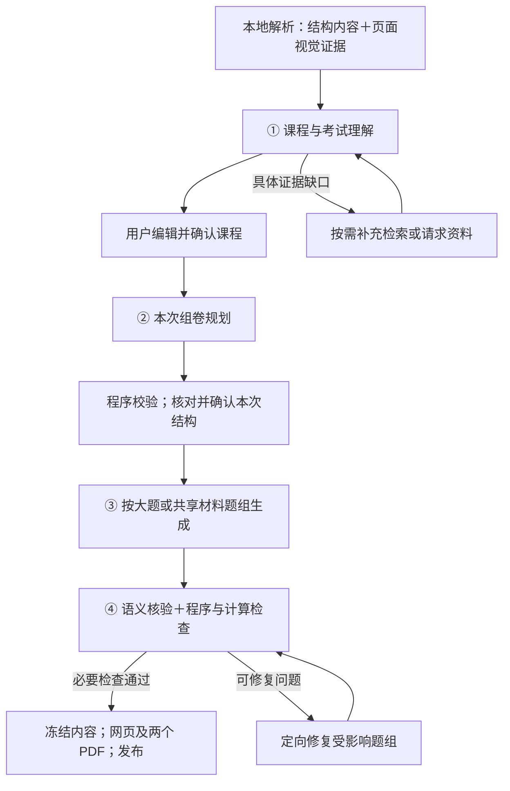

# AI 技术方案 v0.1：初步设计

| 项目 | 内容 |
|---|---|
| 文档版本 | v0.1 |
| 整理与官方资料查询日期 | 2026-10-18（Asia/Shanghai） |
| 需求依据 | [正式 PRD v1.0](PRD-v1.0.md) |
| 架构依据 | [前后端技术方案 v0.2](technical-design-v0.2.md) |
| 流程依据 | [AI 处理流程计划](<AI 处理流程计划.md>) |
| 决定状态 | 用户已确认本初步方案，作为后续设计基线；模型与工具保留正文中的候选及待验证状态 |
| 验证状态 | 尚未据此安装配置工具、调用付费模型或执行真实材料处理与评测；质量、耗时、成本和运行边界尚待验证 |

## 1. 总体建议、约束与待决问题

**首版采用：一个主模型承担四个 AI 环节，本地解析和证据管理提供输入，程序负责确定性检查与计算，复杂或存疑题再独立求解。** 先建立这条可解释、可比较的基线，再根据实测收益增加模型分工。

本方案停留在技术设计层，说明处理思路、选型理由与待验证问题。完整提示词、详细数据 schema、接口字段、调用配置和开发任务清单留待后续方案确认后展开。

### 1.1 现有约束的决定状态

| 状态 | 本方案的理解 |
|---|---|
| 已确认的产品要求 | 支持规定的五种文档格式及数字文档内的公式、表格和图形；课程与结构需要确认；完整卷和章节练习均为首版功能；最终交付网页和两个 PDF |
| 已采用的流程方向 | 四个核心 AI 环节；固定工作流；分层核验；复用课程理解；按大题或共享材料题组生成 |
| 流程基线 | 受控并行、定向修复、最多一轮内容修复；具体收益和适用边界仍需验证 |
| 既有技术方向 | PostgreSQL、私有文件和同库检索继续沿用；Django、任务库及 PDF 工具等仍按前后端技术方案中的推荐状态看待 |
| 本方案的初步选型 | 主模型、解析路径、证据供给方式、调用组织和最小计算能力按后文作为设计基线推进 |
| 仍待真实材料验证 | 内容质量、解析可靠性、输入输出规模、两分钟可行性、成本及运行预算 |

本轮已明确的用户偏好：**可以考虑海外官方 API，按供应商支持范围选择部署地域；优先保证质量和两分钟目标，费用预算在真实基线后确定。**

贯穿整个方案的边界是：**属于考试范围、有足够依据出题、通过用户确认，是三个分别记录的判断。**

## 2. 总体流程与四个环节

| 环节 | 输入类别 | 推荐处理思路与分工 | 输出类别 |
|---|---|---|---|
| ① 课程与考试理解 | 教学内容、明确范围、试卷与答案、解析问题、人工修改 | 模型统一理解课程知识和考试特征；程序管理来源、覆盖、冲突及修改。小规模整体处理，大规模分批理解后汇总 | 可编辑课程草稿、考试模板、来源依据、冲突与缺口 |
| ② 本次组卷规划 | 确认课程、本次配置、历史覆盖及参考题特征 | 程序继承适用模板并校验硬约束；模型安排知识组合、作答要求、难度和必要结构调整 | 整卷蓝图、题组安排、计划覆盖、所需证据与素材 |
| ③ 题答及素材生成 | 确认蓝图、相关课程证据、参考题特征 | 每个题组一起形成条件、题目、答案、评分和素材；独立题组受控并行；程序承担计算及素材绘制 | 完整候选题答、评分点、必要图表和知识关联 |
| ④ 语义核验与必要修复 | 候选内容、课程依据、确认结构、程序检查结果及重复候选 | 模型核查语义和课程适配；程序检查结构及适用计算；疑点触发独立求解和定向修复 | 检查结论、问题依据、修复结果及未核验项目 |

① 的分类、局部提炼和整体汇总属于同一职责。③ 内部也可以包含计算工具调用。**四个环节是职责边界，调用次数由任务决定。**

## 3. 模型选型：先共用主模型，再验证分工价值

### 3.1 主模型与少量备选

**以 GPT-6.1 Sol 作为首版主模型候选，四个环节先共用。** 它支持图像输入、结构化输出和工具调用，可以覆盖本项目所需的主要能力。官方将其定位为复杂任务中平衡能力与成本的选择；课程出题质量仍需本项目验证。[OpenAI 官方模型资料](https://developers.openai.com/api/docs/models/gpt-6.1-sol)

以下价格为 **2026-10-18 查询时的快照**，单位为美元／百万文本 token，输入与输出分别计费；缓存、长上下文、工具和加速服务另按对应规则计算。后续选型与预算冻结时重新核对官方资料。

| 候选 | 建议角色 | 输入／输出价格 | 选择理由与限制 |
|---|---|---|---|
| GPT-6.1 Sol | 主模型基线 | $2／$10 | 覆盖四个环节所需能力，适合先建立统一基线；本课程正确率和完整耗时待测。[官方资料](https://developers.openai.com/api/docs/models/gpt-6.1-sol) |
| GPT-6 Astra | 困难题和质量对照候选 | $10／$50 | 官方定位为更强的复杂推理模型。用于判断额外能力能否显著减少严重错误，及其耗时是否可接受。[官方资料](https://developers.openai.com/api/docs/models/gpt-6-astra) |
| Claude Sonnet 5.5 | 替代主模型、跨供应商评估候选 | $2／$10 | 支持文本和图像，官方强调速度与能力平衡。适合与 Sol 比较，也可用于离线独立解题；本课程表现待测。[官方资料](https://platform.claude.com/docs/en/models/sonnet-5-5/overview) |
| Gemini 3.8 Flash | 速度与成本对照候选 | $0.75／$3.75 | 支持多模态、结构化输出和工具调用；价格为截至 2026-12-31 的优惠价，之后为 $1.50／$7.50。复杂计算和长答案质量需重点比较。[模型资料](https://ai.google.dev/gemini-api/docs/models/gemini-3.8-flash)、[价格](https://ai.google.dev/gemini-api/docs/pricing) |

OpenAI 表中列的是短上下文基础价。Sol 输入超过 272K token 时，官方公布了更高的整次请求计价，因此“大窗口可容纳”也需要结合实际费用判断。[计价说明](https://developers.openai.com/api/docs/models/gpt-6.1-sol)

### 3.2 共用模型与核验分工

先共用模型的理由：

- 减少接入、模型差异和故障处理的变量，方便判断问题来自材料、流程还是模型。
- 同一模型可以根据任务复杂度采用不同处理深度，无须为每个环节指定一个型号。
- 当前缺少实测证据，尚不能证明引入轻量分类模型或专用审核模型能提高端到端效率。

**核验仍需隔离上下文。** 普通语义审核可以看题目和答案；独立求解先只看题目及必要课程依据。共用模型仍可能共享错误，因此离线评测优先引入另一模型家族，并结合客观计算检查。

### 3.3 接入条件

接入条件包括账号资格、计费额度、支持地域、速率限制和数据保留设置。可以在供应商支持范围内比较部署地点；海外主机本身不代表所有接入条件已满足。[OpenAI 支持范围](https://developers.openai.com/api/docs/supported-countries)、[Claude 支持范围](https://platform.claude.com/docs/en/api/supported-regions)、[Gemini 支持范围](https://ai.google.dev/gemini-api/docs/available-regions)

本方案确认的是选型方向，尚未验证项目账号的实际可用权限或完成外部服务接入。

## 4. 材料理解与证据供给

**采用“本地结构化解析＋页面视觉证据”的双重表示。** 结构内容便于检索、引用和复用；页面图或局部图用于保留公式、图形和复杂布局的真实呈现。

### 4.1 解析路径

**首选候选为 Docling，旧版 DOC/PPT 配合 LibreOffice 转换。** 官方列出了 PDF、DOCX、PPTX 和旧版 Office 格式支持，并提供文档层级、表格、图片和来源信息表达。格式支持声明仍需逐项用真实材料核验。[支持格式](https://docling-project.github.io/docling/usage/supported_formats/)、[文档表示](https://docling-project.github.io/docling/concepts/docling_document/)

| 内容 | 推荐处理方式 |
|---|---|
| 文本 | 保留章节、列表、定义及阅读顺序，形成可定位内容 |
| 公式 | 保留符号、上下标和适用条件；必要时结合原生公式与局部图理解，可靠性不足时标记缺口 |
| 表格 | 保留行列、表头、单位、脚注及跨页关系，重要数值可回看原表 |
| 图形 | 保留原图，并理解坐标、图例和教学用途；需要精确数值时优先取得原始数据或明确标注值 |

Docling 的公式和图片增强会增加额外模型处理时间，按内容需要启用，并比较其与主模型视觉理解的效果。[增强功能说明](https://docling-project.github.io/docling/usage/enrichments/)

官方 API 直接读取文件可以作为对照路径。例如 OpenAI 对 PDF 提供文本和页面图，但对 Word、PPT 等非 PDF 文档主要提取文本，内嵌图形不会自动进入上下文。采用直接文件输入时，也必须验证图形供给和定位能力。[文件输入说明](https://developers.openai.com/api/docs/guides/file-inputs)

### 4.2 整体理解、分批、长上下文与检索

采用组合方式：

| 情况 | 采用方式 |
|---|---|
| 首次建立课程 | 覆盖全部相关材料，形成整体课程理解；完整范围说明始终保留 |
| 材料规模较小 | 整体分析，减少分批和汇总开销 |
| 材料规模较大 | 按完整章节、例题或试卷题组分批，再汇总跨材料关系 |
| 每次出卷 | 读取确认课程、整体规则和目标题组所需原始证据 |
| 更新材料 | 复用未变化成果，重新处理变化材料及受影响结论 |

分批时保留公式与解释、表格与脚注、题干与全部小题的关系。首次课程分析需要逐材料、逐章节的覆盖记录；出卷阶段再围绕目标检索证据。

首版检索优先使用既有 PostgreSQL：**知识点与章节关联、来源类型、全文检索，加上完整语义单元回取。** 如果真实样本显示同义表达或跨章节证据召回不足，再评估同库向量检索。PostgreSQL 已提供全文检索能力。[官方文档](https://www.postgresql.org/docs/current/textsearch-intro.html)

来源定位和来源是否支持结论分别检查。生成的新场景与数值属于合成内容，课程证据主要支持其知识、方法和约定。

## 5. 调用组织、程序分工与核验恢复

### 5.1 合并和拆分原则

- **合并**：材料分类、知识提炼和考试特征理解可在一次材料分析中共同完成；题目、答案、评分和共享素材在同一题组内生成。
- **拆分**：课程理解与本次出卷之间存在用户确认边界；生成与审核承担不同职责；独立求解需要隔离生成答案。
- **并行**：独立材料批次、独立题组，以及可并行的检查项；共享条件或前置结论的内容一起处理。
- **复用**：解析结果、材料理解、确认课程、模板、来源关联和参考题特征；再次生成时重新安排本次题目，继续检查重复。

**默认按大题或共享材料题组生成。** 相比逐小题生成，它更容易保持共享条件和解题连续性；相比整卷一次生成，它更便于并行、恢复和定向修复。较短章节练习可以整体生成，颗粒度由依赖关系和输出规模决定。

### 5.2 最小配套能力

| 能力 | 推荐方向 |
|---|---|
| 模型调用 | 官方 SDK 加少量业务封装，沿用后端任务执行器 |
| 文档处理 | Docling＋必要的 LibreOffice 转换，保留原文件和视觉证据 |
| 证据检索 | PostgreSQL 内的关联与全文检索 |
| 确定性检查 | 程序检查题数、分值、选答、引用及题答完整性 |
| 计算核验 | Python 十进制／精确数值计算；适用时使用 SymPy 等符号计算能力 |
| 素材与交付 | 受控表格和图形绘制，沿用前后端技术方案的数学及 PDF 渲染方向 |

十进制计算适用于金额和精度要求，符号计算可辅助方程等已支持任务；这些能力仍需限定适用题型和计算约定。[Python Decimal](https://docs.python.org/3/library/decimal.html)、[SymPy 求解说明](https://docs.sympy.org/latest/guides/solving/solve-equation-algebraically.html)

计算检查应尽量从**题目条件和课程方法**复算。仅重新执行模型提供的算式，只能证明该算式的计算一致性，方法适用性仍需核查。

首版继续保持既有架构的收敛：暂不增加通用 Agent 框架、模型网关、独立向量服务、逐卷投票和通用代码执行环境。

### 5.3 核验与恢复原则

| 情况 | 处理原则 |
|---|---|
| 关键证据不足 | 说明缺口；按需补充检索。仍不足则请求材料或调整范围 |
| 疑似实质重复 | 先用知识、条件和解法特征寻找候选，再比较原题；同时检查同卷题目 |
| 程序或语义检查失败 | 给出具体问题和依据，定向修复受影响题组 |
| 必须改变确认结构或课程依据 | 返回相应确认环节，使用新快照恢复 |
| 修复后仍有关键问题 | 按预算停止，保留配置、成果及失败原因 |
| 仅 PDF 失败 | 复用冻结内容恢复导出 |

沿用流程基线，默认最多一轮内容修复；修复后重新执行受影响检查和整卷结构检查。实际重试与运行预算仍须按 PRD 在上线前冻结。

在线检查负责每份卷的必要交付条件。离线评测负责更广泛的独立求解、难度风格校准、重复倾向、误阻断及版本比较。离线还应抽查在线未触发独立求解的题，以发现分层策略的漏检。

## 6. 两分钟目标、待验证问题与后续设计顺序

### 6.1 耗时与成本关注点

**完整题答输出、推理、审核和修复，很可能比接口往返更值得优先关注。** 官方延迟指南也将输出生成量、请求次数和并行列为主要优化方向。[延迟优化说明](https://developers.openai.com/api/docs/guides/latency-optimization)

两条主线分别观察：

- **课程分析**：排队、尚未完成的解析、视觉理解、分批分析及整体汇总。
- **完整生成**：证据准备、题组生成、程序和语义检查、必要独立求解与修复、网页和两个 PDF。

优先优化复用成果、减少重复读取、题组并行和定向修复。完整示例答案、必要解释和 PDF 保持 PRD 要求。配置阶段的蓝图规划另记耗时，同时观察用户完整等待，避免阶段拆分掩盖实际体验。

供应商输入缓存可以作为优化候选；需要核对命中、写入费用和保留规则。它与应用保存的课程成果分别管理，也不会消除新题输出的生成工作。[缓存说明](https://developers.openai.com/api/docs/guides/prompt-caching)

### 6.2 风险与验证方向

以下是后续验证设计，本轮未执行试验：

| 待验证问题 | 将来如何比较 |
|---|---|
| 公式、表格和图形是否可靠解析 | 选三门课中的关键样本，对照原文核查缺失、错读、定位和处理耗时 |
| 主模型是否合适 | 固定相同证据与任务，比较严重错误、范围符合、答案完整性、难度和完整耗时 |
| 整体处理还是分批更合适 | 比较遗漏、跨材料冲突识别、来源支持、调用量和总成本 |
| 生成颗粒度是否合适 | 比较整卷、大题和共享题组的整卷一致性、重复、修复率及端到端耗时 |
| 分层核验是否有效 | 植入已知问题，并盲查正常输出，分别记录漏检、误阻断和计算覆盖 |
| 两分钟是否可达 | 使用冻结的真实规模和负载，记录冷／热状态及全部受理任务结果 |
| 费用是否可接受 | 按实际输入、输出、推理、图像、工具和重试用量核算，比较每份合格交付的成本 |

先用代表性小样本筛选路径，再按 PRD 的 **18 个固定任务、每任务三次**进行正式版本评测。供应商文件、缓存和日志的保留方式也需实际核对；“不用于训练”与“零保留”是不同设置。[OpenAI 数据控制说明](https://developers.openai.com/api/docs/guides/your-data)

### 6.3 后续设计顺序

**材料解析与来源定位 → 主模型及对照模型 → 证据供给与题组边界 → 核验覆盖和修复策略 → 规模、并发、成本与时间预算。**

这些方向确认后，再展开提示词、数据 schema、接口及调用配置。任何后续实测导致的候选替换、范围或验收口径变化均应记录依据，不把本初步方案的确认视为性能、质量或生产可用性已经验证。
