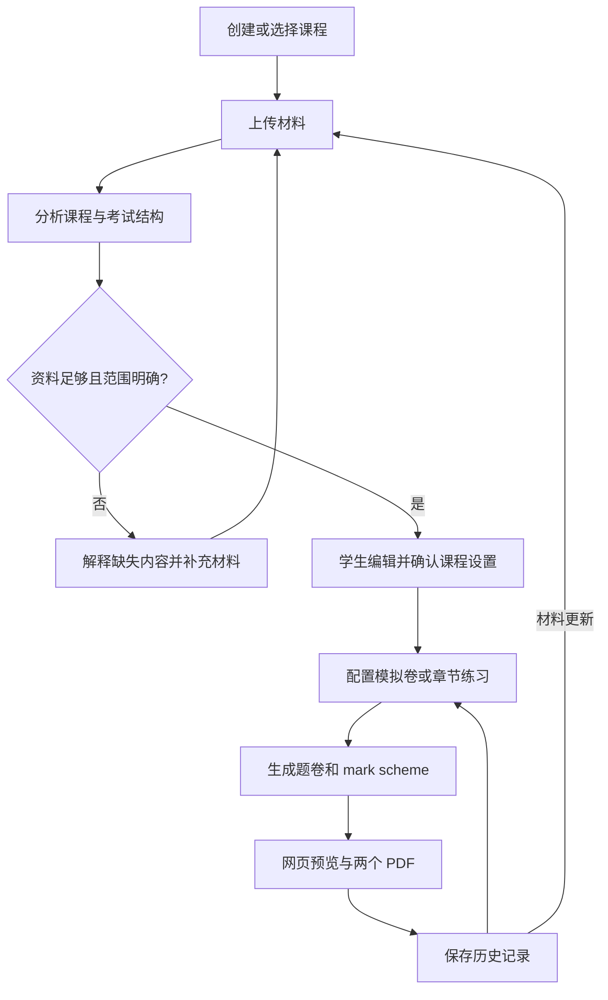

# AI Past Paper Generator — 初步需求文档 v0.1

更新日期：2026-10-16。状态：需求对齐与交互原型；尚未实现真实 AI 服务。

## 产品目标与边界

为大学生提供课程专属的模拟试卷和 mark scheme。学生上传少量历年试卷及课程资料，系统理解本课程的考试范围、知识深度和出题方式，在已确认范围内生成新题，供学生练习和自行核对。

Accounting、Business Analytics（BA）、Quantitative Maths（QM）是第一批测试课程，不是产品仅支持的三个学科。完整模拟卷与章节练习同等重要。第一版同时面向本地自测和小规模受邀线上试用；线上用户拥有独立账户与课程空间。

### 已确认范围

- 英语界面、英语试卷与英语 mark scheme。
- PDF、PPT/PPTX、Word；支持数字文档内的图像、图表、公式和表格；不支持扫描件和手写内容。
- 学生先直接编辑并确认课程范围和考试结构，再生成。
- 可指定章节、整卷难度、题型和大题数量；结果显示小题数量。
- 每次生成一套，支持再次生成整卷；第一版不做批量出卷或单题替换。
- 网页预览，以及题卷和 mark scheme 两个独立 PDF。
- 支持按课程考试要求使用财务报表、统计/数学图表及公式表。
- 以纸笔、计算器可完成的考试任务为范围，不包含需要 Excel、Python、R 环境或代码/数据集交付的任务。
- 不接收学生作答，不自动批改，不做学习成绩预测。

## 1. 用户流程

1. 创建课程，上传教学资料和明确的当前考试范围；可补充 past/mock papers、官方答案、mark scheme 和 rubric。
2. 系统识别材料类型、关联试卷与答案，并分析内容和来源。缺少必要材料时指出原因及需要补充的部分。
3. 展示可编辑的课程知识树和考试结构。学生核对纳入/排除章节、掌握深度、题型、题量、分值、考试时间与选答规则。
4. 保存已确认的课程设置。再次使用同一课程时可直接配置练习；材料更新后保留人工修改，展示差异和冲突，重新确认受影响内容。
5. 选择完整模拟卷或章节练习，指定章节、整卷难度、题型和大题数。
6. 生成新题及对应 mark scheme，完成预览和两份 PDF 后标记任务完成。
7. 学生先看题卷，主动切换到答案核对；可分别下载、打开历史记录或再次生成。

Gold set 和独立解题是开发测试机制；学生流程不包含人工审核每份试卷的环节。产品的核心任务是生成新题。

## 2. 页面与交互结构

### 2.1 课程入口

- My courses：创建、选择和删除课程；展示课程状态。
- 线上账户隔离课程资料与历史。原型只演示本地账户入口，不实现登录。
- 课程内固定导航：Materials、Course profile、Generate、Papers。

### 2.2 Materials

- 拖放或选择多个文件，显示类型、状态与关联关系。
- 材料类型可以修正；官方答案可关联到具体 past paper。
- 明示必需教学资料及考试范围；past paper、官方答案和 rubric 为可选材料。
- 文件错误定位到具体文件与页码/幻灯片，说明其对分析范围的影响。
- 提供分析、替换和补充入口。更新文件不默默覆盖人工确认内容。

### 2.3 Course profile

- 摘要优先；不确定及冲突内容集中显示，可展开原文证据。
- 直接编辑章节名称、纳入范围、知识要求及掌握深度。
- 编辑考试时长、总分、分区、题型、每区题数和分值、必答/选答规则。
- 证据区分：资料明确说明、past paper 推断、外部补充、用户修改。
- 分值、题数和选答规则进行一致性校验。修改与当前 syllabus 冲突时解释冲突。
- 确认课程版本；生成使用该版本。本次练习参数不自动覆盖课程默认值。

### 2.4 Generate

- 完整模拟卷与章节练习并列呈现。
- 选择已确认范围内的章节、允许的题型、整卷难度、大题数；显示预计小题数、总分和时长。
- Foundation：单一知识点与直接应用；Exam-standard：参考考试的推理深度与综合程度；Challenge：在范围内增加整合和推理。
- 没有 past paper 时明确难度未校准。
- 显示真实处理阶段和已用时间，不伪造完成百分比。
- 配置冲突在生成前解释并处理。取消保留输入；失败可重试。

### 2.5 Papers

- 历史列表与详情；默认显示 Question paper，主动切换 Mark scheme。
- 题卷展示考试说明、题号、小题、分值、必要表格和图形。
- 两个独立 PDF 下载入口；两个文件及完整预览全部就绪才算完成。
- 查看本次配置、课程版本、覆盖范围和适当的来源说明。
- 旧试卷保留当时配置和结果；课程后续编辑不改写历史。

## 3. 数据来源与使用规则

| 来源 | 作用 | 必需性 |
|---|---|---|
| 当前 syllabus 或其他明确考试范围说明 | 确定纳入与排除范围 | 必需 |
| Lecture、seminar、handout 等教学资料 | 内容、定义、方法、知识深度 | 必需，需支撑目标范围 |
| Past paper / mock paper | 出题风格、结构、复杂度与知识组合 | 可选；有则优先参考 |
| 官方答案 / mark scheme | 正确方法、答案表达、评分习惯 | 有则纳入 |
| Rubric / marking guidance | 评分标准及分值依据 | 可选；实际可用性待确认 |
| 小练习与答案 | 补充知识覆盖和基础正确性参照 | 可选 |
| 外部资料 | 补充已确认范围内的缺失内容 | 可使用，必须说明原因、来源及补充内容 |

优先规则：当前明确考试范围决定考什么；历年试卷不能扩大当前范围。教学资料决定课程使用的方法与深度；历年试卷优先用于风格与复杂度，官方评分材料用于评分依据。来源之间无法合理消解的关键冲突需要展示并处理。

只有 past paper 和答案不足以建立课程；只有课件但没有明确考试范围也不足。完整模拟卷需资料支撑整份目标范围，章节练习只要求支撑所选范围。网络补充后仍不足时暂停，允许补充或调整范围，不输出半份试卷。

无 past paper 可以继续；缺少考试结构时提出标明为推断的结构，交由学生编辑确认。

### 当前测试材料

| 课程 | 正式试卷与官方解答 | 其他练习 |
|---|---:|---|
| Accounting | 2 套 | 含答案，覆盖大部分考试章节 |
| Business Analytics | 2 套 | 含答案，覆盖大部分考试章节 |
| Quantitative Maths | 1 套 | 含答案，覆盖大部分考试章节 |

小练习的难度与综合程度低于正式考试。现有官方解答有解题过程，但未提供详细分步分值；rubric 是否可获得仍待确认。课程包含计算、解释及较长案例/论述任务。

## 4. 核心处理逻辑

1. **材料处理**：解析数字文本、结构、图表和公式，记录文件与页码来源，关联试卷和解答，保留解析不确定项。
2. **课程建模**：建立章节/知识点、学习要求、考试范围、深度和依赖；标记资料依据与推断。
3. **考试建模**：提取题型、分区、分值、时长、选答方式、认知复杂度、计算量及跨章节组合方式。
4. **用户确认**：直接编辑，校验结构一致性，保存课程版本。补充资料后保留人工修改并提示差异。
5. **出卷组织**：将目标章节、难度、题型、题量映射到试卷结构。单卷优先匹配真实考试形态，多次生成逐步扩展覆盖；不承诺固定套数覆盖全部知识。
6. **新题与解答**：生成条件充分、范围内的新题及相互对应的答案、过程和评分说明。不同难度通过推理与综合要求区分，不能靠引入范围外知识制造难度。
7. **一致性处理**：检查题号、分值、题量、答案对应与可计算部分。避免与上传题目或本课程历史出现实质重复。
8. **展示与保存**：渲染预览和两份 PDF，记录材料/课程版本、配置、生成时间及任务状态。

实质重复指题目结构、条件组织与解题路径基本一致，仅替换数值或人物名称；考查相同知识点本身不算重复。

建议保留的业务对象为课程、材料及来源定位、课程版本、练习配置、任务状态、题卷、mark scheme 和历史记录。本阶段不冻结技术栈、API 协议或数据库结构。

## 5. 输出与结果展示

### Question paper

英语；含课程与练习名称、说明、时长、总分、必答/选答规则、题号与小题分值，以及题目必要的表格/图形/公式表。不能泄露答案。

### Mark scheme

- 计算题：结果、计算步骤、评分点、建议部分分及适用的其他方法；注明单位、精度与舍入要求。
- 解释题：必要观点、解释和评分点。
- 论述/案例题：完整示例答案、要点、建议分值、可接受的其他论证。
- 评分分配没有官方细则支持时标明建议性质；不把生成的 mark scheme 描述成官方答案。
- 来源可在课程分析或答案证据区查看，避免题卷来源提示直接暴露解法。

资料、课程设置和历史默认保留至用户删除。线上隔离属于正式产品要求，原型的浏览器本地存储不等同于账户隔离。

## 6. 异常处理

| 情况 | 处理 | 恢复方式 |
|---|---|---|
| 缺少教学资料或明确考试范围 | 暂停并列出缺失项 | 补充材料后分析 |
| 无 past paper | 明示结构和难度未经历年卷校准 | 确认建议结构后继续 |
| 当前范围与旧试卷不一致 | 以当前范围为准并解释来源 | 核对排除项 |
| 其他关键资料冲突 | 展示双方证据，暂停受影响任务 | 用户澄清/补充 |
| 扫描/手写、不支持格式、文件损坏或局部解析失败 | 指明文件、页面、影响 | 替换、补充或调整范围 |
| 目标范围教学证据不足 | 可寻找有标注的外部补充，仍不足则暂停 | 补充或缩小练习范围 |
| 结构总分、题数、选答规则不一致 | 就地提示冲突 | 修正配置 |
| 分析/生成超过两分钟 | 标记超时并继续后台运行，可取消 | 等待、取消或重试；计为性能未达标 |
| 模型或生成失败 | 保留资料、课程及配置并给出原因 | 重试 |
| PDF 生成失败 | 不显示整体完成 | 重试导出，已有中间结果保留 |
| 用户取消 | 停止该任务、保留配置 | 再次发起 |

## 7. 如何启动

### 已交付的第一阶段原型

- 文件：`../prototype/index.html`。双击或用浏览器打开即可，无需依赖、API key 或服务器。
- 顶部始终标明 **Prototype — sample data**。使用 Scenario 切换正常与异常演示。
- 演示三门课、课程创建、材料类型修改、资料更新提示、课程确认、出卷配置、生成进度、预览及历史。
- 所选文件只保留文件名和类型等元数据，不读取内容、不上传；所有课程内容与题目均为预置演示。
- 使用浏览器 localStorage 保存演示状态。文件模式下存储行为依浏览器而异；不可用时退回当前页面内存并提示。
- 下载按钮说明正式 PDF 的交付方式，不伪造可下载的正式试卷；无真实 AI 生成、联网补充、登录或文件解析。
- 原型内章节、时间、题目、来源引用和评分均为示例，不能用来验证真实学术质量或两分钟性能目标。
- 原型中大题数暂限制为 1–12，仅为演示范围，不是已确认的产品上限。
- 完整模拟卷修改大题数时，原型明确切换为该次练习专用的必答布局；章节练习按每题 10 分、15 分钟演示。这些是原型规则，不作为正式课程估时或评分规则。

### 正式产品启动要求

后续交付应包含环境配置说明、模型及服务配置、启动命令、本地访问地址，以及小规模邀请试用的账号和访问方式。当前没有正式后端，不能提供真实产品启动命令。模型、部署平台、运行成本和预算限制待评估，不在本轮自行冻结。

## 8. 如何验收

### 8.1 原型验收

- 能走通创建课程→材料→课程确认→配置→生成演示→结果→历史。
- 直接编辑课程范围及结构可保存，生成页使用确认后的设置。
- 返回页面不丢失输入，材料更新保留人工编辑并要求重新确认。
- 完整模拟卷和章节练习都可操作；题卷与答案分开；每次生成一套。
- 历史保存当次配置/课程快照，不随之后的课程编辑而变化。
- 关键异常明确说明原因和下一步；取消及重试有效。
- 英语界面；桌面与窄屏可用；键盘可操作主要控件。

本轮原型验证记录（2026-10-16）：已在 Edge 浏览器中通过主流程及刷新持久化检查，并通过 11 组情景检查，覆盖缺失范围、无历年卷、解析错误、冲突处理、证据不足、超时取消、生成/导出重试、课程快照、选答结构和新课程隔离。另验证了输入后直接点击确认/生成、连续键入和即时校验。检查了桌面、390px 和 320px 窄屏布局；所检查页面无横向溢出，未记录到浏览器脚本错误。这些结果只验证原型交互，不代表正式 AI 内容质量、账户安全、真实 PDF 或性能目标已经通过。

### 8.2 Gold set 的定义与制作

Gold set 是固定的**生成任务、可信参考材料、检查规则和评价准则**，不要求所有新题与某一标准题逐字相同。主任务是生成新题及 mark scheme；独立解答新题只是验证方法。

构建流程：

1. 整理每门课现有材料，标记官方试卷/解答、小练习/答案、范围及 rubric 的可用性。
2. 建立人工核对过的考试范围、知识点、结构及来源清单；区分确定事实、推断和缺失依据。
3. 固定 18 个任务：3 门课 × 2 场景（完整卷、章节练习）× 3 档难度。冻结每个任务的输入资料、课程版本、章节、题型和题量。
4. 每个任务生成 3 次，共 54 份正常输出；另建缺资料、冲突、解析失败、超时等异常样本。
5. 由用户与另一个 AI 按固定评分表评估。先手动记录，评价方法稳定后再自动化。
6. 使用官方题目及答案校准评估者，但不把“AI 解答现成题的分数”当成出卷质量。
7. 正式基线跑完后再确定开放题质量、重复率等阈值；保留基线与后续版本，避免按结果随意改标准。

主要测试者为用户和另一个 AI。老师与学过课程的学生仅提供少量定性反馈。AI 之间一致不等于正确；缺乏可独立验证依据的结论标为待核实。

### 8.3 量化维度与口径

| 维度 | 指标与计算口径 | 验收处理 |
|---|---|---|
| 配置符合 | 范围内题数/总题数；题型、数量、总分符合项/检查项 | 固定测试样本要求 100% |
| 可独立解答 | 不看生成答案先解题；独立解答与 mark scheme 一致题数/可比较题数 | 单独报告，不能视作正确率 |
| 客观正确性 | 可计算项覆盖数/相关项；规则/数值检查通过数/已检查项 | 分别报告覆盖与通过；容差按题目约定 |
| 来源支持 | 可定位引用/全部引用；有证据支持的课程要求/已核查要求 | 检查来源实际支持关系，不只检查链接存在 |
| 外部补充 | 已说明来源、原因及用途的补充项/全部补充项 | 必须完整标明，不引入范围外要求 |
| 开放题 | 必要要点覆盖、事实错误、答案与评分逻辑一致性 | 有依据部分作为参考金标，其余辅助评价 |
| 难度与风格 | 对认知步骤、综合程度、计算量等固定量表评分 | 分课程、场景、难度报告；阈值基线后定 |
| 新颖性 | 实质重复题数/总题数；与上传题和历史分别比较 | 仅换数字或名称算重复；阈值基线后定 |
| 覆盖 | 多次生成累计覆盖知识点数/目标知识点数 | 报告曲线，不承诺固定 N 套覆盖全部 |
| 异常 | 正确处理数/异常样本；误阻断数/可继续样本；漏阻断数/应暂停样本 | 分类型报告，定位失败样本 |
| 可读性 | 缺页、截断、公式/图表损坏和题答错位数/检查项 | 网页和两个 PDF 均核验 |
| 性能 | 达到时限任务数/全部任务；记录分布及超时数 | 两项各自计时，失败/超时不从分母移除 |

两个性能目标：上传完成至首版可编辑课程分析 **小于 120 秒**；确认配置并开始生成至完整网页预览与两个 PDF 均就绪 **小于 120 秒**。不计学生编辑等待时间。按三门真实材料规模和最大样本试卷测试，文件数、页数、大小及试卷规格待资料到位后记录；当前尚未证实可达到。

每项报告原始分子、分母和样本数，按课程/场景/难度拆分。已验证的严重内容错误单列，不能用其他维度高分抵消。没有官方细则时，不把生成的建议分值作为金标；合理的不同答案不因与示例措辞不同而判错。

### 待评估事项

真实材料的体量与质量；rubric 可用性；实际成本、模型与部署；正式质量阈值；两分钟目标的实测可行性。以上不阻止本轮原型交付，也不应被描述为已经验证。
