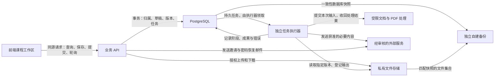
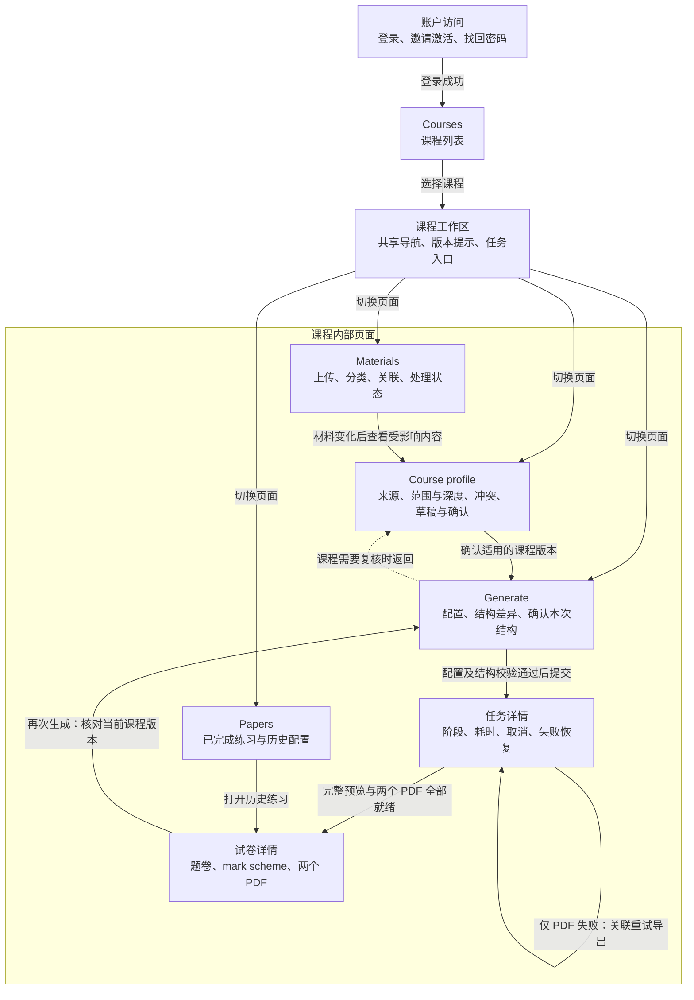

# 前后端技术方案 v0.2：收敛修订稿

| 项目 | 内容 |
|---|---|
| 文档版本 | v0.2 |
| 整理日期 | 2026-10-18（Asia/Shanghai） |
| 适用阶段 | 真实出卷闭环、本地自测、小规模受邀线上试用 |
| 需求依据 | [PRD v1.0](PRD-v1.0.md)及需求讨论中已确认的约束 |
| 文档状态 | 设计方案；已确认、推荐及待验证事项按正文分别标注 |



箭头表示调用或数据流。这些是逻辑职责，不意味着八个独立服务。API 和执行器使用同一后端代码库；受限处理只负责文档转换、解析和 PDF 等操作。图中的外部模型与邮件服务分别审核和配置，不代表同一供应商。

**本版保留已经确认的架构收敛，补齐具体技术推荐和前后端契约。** 新增技术推荐不追溯为此前已批准的决定。文档保存及前端流程图合并不表示推荐选型已经完成集成验证，也不代表产品已经实现、部署或通过验收。

当前已有可点击原型与模型接入准备，尚无正式前后端实现；原型中的题数、分值、时间和模拟数据不进入正式产品规则。

## 一、技术组合与选择依据

| 部分 | 本版主方案 | 对比与选择理由 | 维护成本或风险 |
|---|---|---|---|
| 前端应用，已确认 | React＋TypeScript＋Vite | 对比 Next.js：本产品主要是登录后的工作区，暂不需要服务端页面渲染；静态前端和业务 API 足以承载流程 | 前后端接口需要明确管理 |
| 路由与服务器数据，已确认方向 | React Router Data Mode＋TanStack Query，严格限制职责 | Router 管导航、布局、错误边界和离开提醒；Query 管服务器数据。对比同时使用 Router loader 缓存和 Query：避免两套数据刷新机制 | 必须保持唯一服务器缓存入口；不引入额外全局状态库 |
| 表单，已确认 | 简单表单用原生控件；复杂表单用 RHF＋Zod | 对比所有字段都手写状态：课程结构、选答和配置表单更容易统一呈现错误；简单登录表单无需套用复杂结构 | Zod 只做前端反馈，不能代替后端裁定 |
| 视觉与基础组件，本轮推荐 | CSS Modules＋CSS 变量；原生控件优先，复杂对话框等按需使用 Radix | 对比整套后台组件库：当前页面种类有限，按需组合更容易控制题卷排版和课程编辑体验 | 需要维护少量公共组件及键盘行为 |
| 后端框架，本轮推荐 | Python＋Django 5.2 LTS＋DRF；Django ORM 与迁移 | 对比 FastAPI＋SQLAlchemy＋Alembic：邀请登录、密码恢复、会话和数据管理占比较高，Django 可减少基础能力拼装 | 框架约定较多；课程和文件归属授权仍须自己实现 |
| 任务运行，本轮推荐 | Procrastinate＋PostgreSQL，独立执行器 | 对比 Celery＋Redis：首版可减少一个常驻基础组件；对比自写完整队列：复用领取、重试、锁和运行管理能力 | 仍需实现业务取消、版本检查和发布规则；该项目正在招募维护者，依赖维护情况必须纳入评审 |
| 数据与文件，已确认方向 | 自管 PostgreSQL＋服务器私有持久化目录＋同库检索 | 对比独立对象存储、向量服务：当前尚无多主机共享或独立检索扩容的实测需要 | 数据库与文件需要配套备份；磁盘容量与清理需监控 |
| 网页数学与 PDF，本轮推荐 | KaTeX；可信打印模板＋Playwright/Chromium | 对比 MathJax：先验证 KaTeX 能否覆盖真实公式；对比 WeasyPrint：Chromium 可沿用网页的公式、字体和部分排版规则 | 浏览器进程占用资源，分页仍需单独验证；不支持的公式不能静默丢弃 |
| 部署，本轮推荐 | 单台 Linux 主机＋Docker Compose＋Caddy，同源访问 | 对比 Kubernetes 或多服务平台：首版不需要集群编排；API、执行器仍分进程运行 | 单机存在故障停机风险，需要独立备份及恢复演练 |

React Router 的 Data Mode 和 Query 的后台刷新能力有明确官方说明，但两者如何分工是本产品的设计约束。[Router 模式](https://reactrouter.com/start/modes)、[Query 默认行为](https://tanstack.com/query/latest/docs/framework/react/guides/important-defaults)

Django 提供认证、会话等基础能力，5.2 属于 LTS；Procrastinate 提供 PostgreSQL 队列和 Django 集成。这些文档不能代替本产品的集成测试。[Django 认证](https://docs.djangoproject.com/en/5.2/topics/auth/)、[支持周期](https://www.djangoproject.com/download/)、[Procrastinate](https://procrastinate.readthedocs.io/en/stable/)

**首版不默认加入** Redis、独立向量数据库、对象存储集群、微服务、实时推送、通用工作流引擎或模型网关。现有 LiteLLM 准备也不自动成为正式运行依赖。

替代方案只在明确触发条件下重新评审：例如公式样本不适配 KaTeX、队列维护或兼容验证不通过、多主机需要共享文件。不会同时维护两套同类方案。

## 二、前端：页面、组件、状态与排版

### 前端页面流程图



实线表示页面导航或操作完成后的去向；虚线表示需要补齐前置条件的返回路径。工作区中的页面可以自由切换，提交生成时才检查课程版本、配置和结构是否满足要求。图中都是前端页面与布局，不代表独立部署服务。图示表达本版页面组织，不新增 PRD 之外的业务功能。

| 模块 | 职责及设置原因 |
|---|---|
| 账户访问 | 建立身份，并支持邀请激活和恢复访问 |
| Courses | 管理课程入口，避免不同课程的材料与操作混在一起 |
| 课程工作区 | 持续显示当前课程、版本和任务上下文 |
| Materials | 管理输入资料，说明每份文件是否处理成功 |
| Course profile | 把机器理解变成用户可核对、编辑和确认的课程依据 |
| Generate | 将本次练习配置与课程默认模板分开，先确认结构再出卷 |
| 任务详情 | 承载等待、进度、取消和恢复，支持刷新后继续查看 |
| Papers | 找回已发布练习及当时的配置 |
| 试卷详情 | 集中阅读题卷、主动查看答案，以及下载同版本 PDF |

**用户操作示例：** 用户进入一门课程，上传新的考试说明，在 Course profile 查看来源和范围变化，保留人工修改并确认新版本；随后进入 Generate 调整题量，核对并确认新结构，再提交任务。刷新页面后仍回到原任务；若答案 PDF 失败，就关联重试导出，全部就绪后打开试卷详情，并从 Papers 长期找回。

其中“重试导出”回到的是同一个任务页面模块，后台会创建关联的新导出任务；原失败记录保留，题答内容和练习记录不重复创建。

### 页面与课程工作区

登录后先进入课程列表；进入课程后，统一显示课程名称、当前确认版本、资料待复核提示和进行中的任务入口。

| 页面 | 主要职责 |
|---|---|
| 登录、邀请激活、找回／重设密码 | 受邀邮箱＋密码访问；恢复登录后返回原工作位置 |
| Courses | 创建、进入和删除本人课程 |
| Materials | 上传、替换、分类、答案关联、查看解析状态及来源 |
| Course profile | 编辑课程范围、深度、知识结构和考试模板；保存草稿、处理冲突、确认版本 |
| Generate | 编辑本次配置；查看结构变化并确认；提交生成 |
| Papers | 已发布练习历史；题卷、mark scheme 和两个 PDF |
| Task detail | 当前阶段、耗时、缺口、错误、取消和恢复动作 |
| Course version detail | 只读查看当时确认的课程内容及依据 |

这些页面采用嵌套课程路由；课程标识、任务标识和历史试卷标识进入 URL。刷新和浏览器返回依靠 URL 与服务器数据恢复，不依靠组件仍然留在内存中。

### 核心组件划分

复用限于实际重复职责：

- **工作区组件**：课程导航、版本提示、任务入口、错误和空状态。
- **编辑组件**：表单字段、分值与选答规则、知识点树、结构表格、保存状态。
- **来源组件**：来源列表、定位面板、证据缺口、冲突对照。
- **任务组件**：阶段列表、实际耗时、取消与恢复操作。
- **内容组件**：题目块、公式、财务表格、图形、评分点和下载入口。

不把所有页面都抽象成通用配置引擎。

### 状态的唯一归属

| 数据 | 权威位置 | 前端管理方式 |
|---|---|---|
| 面板展开、当前选项卡、临时焦点 | 当前页面 | React 局部状态；需要分享或恢复的位置写入 URL |
| 尚未保存的输入 | 当前编辑器 | RHF／局部状态 |
| 服务器草稿、材料和列表 | 后端 | Query 缓存 |
| 已确认课程版本、冻结题答 | 后端不可变快照 | 按版本标识查询 |
| 任务阶段、取消和结果状态 | 后端 | 轮询；前端不自行推进状态 |

Course profile 自动保存，并保留 **Save now**：

1. 保存请求串行发送，携带预期草稿修订。
2. 保存期间的新输入继续保留，旧响应不能覆盖新输入。
3. 版本冲突暂停自动保存，显示服务器内容与本地修改。
4. 确认课程前先保存；确认针对服务器已保存的明确修订。
5. 新分析由后端合并机器建议和人工修改；前端负责展示差异、来源及待处理冲突。

后台刷新可以更新材料和任务状态，不能直接重置正在编辑的表单。未保存修改在站内离开时提醒；异常关闭后只能保证恢复已经成功保存的草稿，不宣称未上传输入也能恢复。

退出登录清除浏览器内的私有查询缓存；后台任务继续运行。重新登录后重新查询任务和草稿，不重发生成请求。

### 阅读与视觉规则

- 产品界面、题卷和 mark scheme 使用英语。
- 工作区以清晰文字、表格和状态为主；状态不能只靠颜色表达。
- 题卷默认显示，用户主动切换答案；题卷接口和打印模板避免夹带答案。
- 网页使用结构化内容，不直接执行模型输出的 HTML、脚本或任意绘图代码。
- 数学公式使用 KaTeX 的 HTML＋MathML 输出；关闭不必要的信任能力。长公式有明确滚动或拆分策略，不截断。[KaTeX 选项](https://katex.org/docs/options)
- 财务表格使用语义化表头、单位和数字对齐；图形使用受控 SVG 或图片，并保留必要文字说明。
- 长题保持题号、条件、材料和小题关系；PDF 使用独立打印规则处理分页、重复表头和页码。
- 网页与 PDF 共用同一内容版本；不要求两者逐像素一致。
- 桌面优先，同时保证窄屏核心操作、键盘操作、可见焦点和合理阅读顺序；以 WCAG 2.2 AA 为设计目标，实际支持矩阵经过测试后冻结。

PDF 采用下载交付，不开发完整 PDF 阅读器。Playwright 的 PDF 输出支持打印样式，但真实长题和跨页表格仍须视觉检查。[PDF 官方接口](https://playwright.dev/python/docs/api/class-page#page-pdf)

## 三、后端：模块、数据和版本边界

### 保持一个后端代码库

按账户、课程与材料、课程理解、生成与输出、任务与清理划分模块。API 处理授权、短事务和查询；执行器调用同一业务模块执行耗时阶段。

数据库结构遵循“关系负责归属，文档负责内容”：

| 数据组 | 保存方式与边界 |
|---|---|
| 用户、课程、材料版本、文件资产、来源关系、任务、练习 | 关系化，明确归属、外键和唯一约束 |
| 解析结果 | 按具体材料版本及解析版本保存；来源位置不能转指新文件 |
| 知识结构、考试模板、课程草稿 | 带格式版本的 JSONB；来源关系另外登记 |
| 已确认课程版本、生成输入 | 不可变内容及版本清单 |
| 整份题卷与 mark scheme | 同一份内容版本中的结构化文档；题目保留稳定标识 |
| 历史 | 从已发布练习及快照查询，不复制题答正文 |
| 检索 | PostgreSQL 内按课程、资源和版本约束；索引可以重建 |

不建立公共题库，不将每个小题、内容块和人工操作全部独立拆表，也不保存每次按键的永久事件历史。

### 三条必须保留的版本链

**课程：**

`机器分析基础 → 人工修改与冲突 → 当前草稿 → 已确认课程版本`

未修改字段可以接收新建议；人工修改保留；冲突保存双方；无法可靠匹配的知识点明确提示。确认版本不原地改写。

**生成：**

`服务端生成草稿 → 已保存修订与结构确认 → 输入快照 → 生成任务`

生成草稿绑定明确的课程版本。提交后固定材料、解析结果、配置、结构和允许使用的历史参考，执行时不读取“最新版本”替代快照。

**交付：**

`候选题答 → 必要检查 → 冻结内容版本 → 网页及两个 PDF → 发布`

题目、评分点、素材和 PDF 都绑定相同的 `content_version_id`。内容修正产生新候选版本；单纯重导出沿用原内容版本。

### 更新、权限与删除

- 替换材料产生新版本；运行任务继续使用旧快照，新资料进入待复核草稿。
- 删除实际依赖的材料或历史参考时，撤销访问并取消相关任务；晚到结果不得发布。
- 删除材料清理所有文件版本、解析、原文片段、预览、索引及临时副本；历史题答保留，来源显示已删除。
- 删除试卷清理该练习的题答、素材、PDF、索引和含正文的关联副本；删除课程清理整个课程范围。
- 删除先禁止访问，再异步清理；清理失败可重试，不能只隐藏列表。
- 所有查询、任务、关联和下载经过集中归属校验；数据库关系防止跨课程错误关联，并验证跨用户访问。
- 首版以应用授权、关系约束及越权测试为必须措施；RLS 暂不成为上线依赖。后续增加时必须完整验证运行角色、工作进程和连接池。

原文件、预览、图片和 PDF 保存在私有目录；客户端只使用资产标识，经授权下载，不获得服务器路径。

## 四、接口与长任务契约

### 最小接口分工

| 操作 | 执行方式 | 关键约定 |
|---|---|---|
| 登录、退出、激活、密码恢复 | 同步接口；邮件发送可后台执行 | 服务端会话、一次性令牌、统一恢复流程 |
| 查询课程、材料、草稿、历史与来源 | 同步 | 权限过滤、分页、明确版本 |
| 保存课程或生成草稿 | 短事务 | 内容＋预期修订；冲突不能覆盖 |
| 确认课程、确认试卷结构 | 短事务 | 校验已保存修订；结构变化使原确认失效 |
| 上传材料 | 请求负责文件传输，落盘后异步处理 | 每个文件独立反馈；混合上传保留成功项 |
| 材料解析、课程分析、试卷生成 | 异步任务 | 固定输入、稳定任务标识、幂等提交 |
| 自动检查、首次 PDF 导出 | 生成任务内部阶段 | 不拆成前端需要逐步提交的一串任务 |
| PDF 恢复 | 关联的新导出任务 | 原内容版本、保留成功文件，不重新出题 |
| 删除 | 同步撤销访问＋异步清理 | 返回清理任务或状态，显示真实完成情况 |
| 问题反馈 | 同步保存 | 关联任务、内容版本及稳定题目标识；重发幂等 |

接口使用 JSON 和 OpenAPI；DRF 序列化器定义接口，使用 drf-spectacular 生成契约、openapi-typescript 生成前端类型。这样减少手写两套接口类型；前端表单校验仍不替代后端校验。DRF 官方已将内置 OpenAPI 生成功能标为弃用，并推荐相应替代工具。[DRF 说明](https://www.django-rest-framework.org/api-guide/schemas/)

生成请求只提交必要事实，例如：

```http
POST /api/courses/c_123/generation-tasks
Idempotency-Key: op_456
```

```json
{
  "generation_draft_id": "gd_789",
  "expected_revision": 12
}
```

后端读取该草稿已经绑定的课程版本和结构，不要求前端再次发送材料清单与整份快照。

通用约定：

- 草稿修订、任务修订、内容版本分别命名，不能共用一个含糊的 `version`。
- 同一用户、同一操作及幂等标识，重复请求返回原结果；相同标识但不同请求内容报冲突。
- 错误包含稳定 `code`、可读说明、字段问题、是否可重试及诊断标识。
- 前端区分登录失效、无权访问和 CSRF 错误，不能把所有 `403` 都当作需要登录。DRF 会话认证需要特别处理这些语义。[会话认证说明](https://www.django-rest-framework.org/api-guide/authentication/#sessionauthentication)
- 前端即时校验格式、必填和明显数值关系；后端裁定归属、并发修订、结构一致性、资料充分性、配额和发布条件。

### 任务状态与执行

使用业务状态：

`queued → processing → succeeded / failed / needs_info / cancelled`

等待任务也可失败或取消。`needs_info` 释放执行资源；补充后创建新快照和关联任务。成功、失败和取消记录不被重试覆盖。

- API 负责受理、取消和短事务。
- 执行器负责阶段推进、结果提交及失败记录。
- 恢复检查负责发现执行器失联和未完成派发，防止任务永久悬挂。
- 用户通过接口提出操作，不能直接修改状态。

业务任务与持久派发待办同事务保存，再交给队列执行；派发失败可以补派。队列可以重复投递，业务结果不能重复发布。队列参数只携带任务标识，不复制私有材料。

同课程最多一个等待或处理中的分析／生成任务，由数据库约束兜底；材料处理及导出另有全局资源限制。

前端只轮询任务状态。阶段、开始结束时间和错误来自执行器实际记录；不制作随时间自动增长的假百分比。断线显示连接状态，恢复后查询同一任务；刷新和重新登录都不自动重新提交。

**超过 120 秒是未达到目标的附加标记；失败是任务终态；运行上限耗尽表示系统停止继续尝试。** 运行上限和重试预算需要在真实验证后冻结，不能无限运行。

取消一经事务接受，所有后续写入及发布必须检查取消、删除和执行代次；外部计算即使无法立即停止，也不能继续发布。

### 成功条件与恢复演练

生成成功必须同时满足：题答完整、必要检查通过、完整网页内容就绪、两个 PDF 就绪，并完成唯一发布事务。无需逐卷人工审批；课程和结构确认属于输入确认。

完整路径如下：

1. 用户确认配置与结构，提交生成；API 固定快照并返回任务标识。
2. 页面刷新，从课程任务列表恢复该任务并继续轮询。
3. 执行器生成、检查并冻结题答，题卷 PDF 成功，答案 PDF 失败。
4. 原生成任务记为失败；页面可显示已有预览，但明确未完整交付。
5. 用户选择重试导出，创建关联导出任务，复用原题答和成功文件。
6. 两个 PDF 齐备后，完成同一练习的唯一发布。
7. Papers 出现一条完成记录；原失败任务仍保留，导出重试不新增试卷。

## 五、运行保障、验证与后续计划

### 首版运行方式

线上使用同源 HTTPS：Caddy 提供前端静态文件并转发 API；数据库不公开，执行器独立运行。本地通过 Linux 容器／WSL2 尽量保持同一环境，不以 Vite 开发服务器承担线上部署。[Compose 生产部署说明](https://docs.docker.com/compose/how-tos/production/)

受限处理环境只获得本次输入和临时输出空间，不获得数据库、邮件或模型凭据；禁用宏、任意代码执行和不受控外部访问，并限制 CPU、内存、进程、解压规模和运行时间。不能把“用了容器”等同于隔离已经通过，必须验证挂载、网络与权限。[Docker 安全说明](https://docs.docker.com/engine/security/)

其他必须具备的保障：

- 受邀邮箱＋密码；服务端 Cookie 会话、CSRF、登录限流、一次性激活与找回链接。退出撤销会话，密码恢复后撤销旧会话。
- 服务端凭据按角色提供，不进入前端、镜像或日志。
- 文档和外部网页作为不可信数据，不得修改系统规则、权限或执行工具范围。
- 日志保留标识、阶段、耗时、错误、处理版本和可取得的用量；不默认记录完整材料、密钥和不必要身份信息。
- 费用按实际用量与对应价格版本估算，未知数据明确标记，不能记零。
- 反馈关联任务、内容版本和题目标识，无需用户重复上传材料。

### 备份与恢复

保留已经确认的目标：**每日配套备份、最近数据丢失目标不超过 24 小时、失败告警、可恢复内容最多保留 7 天。**

本版推荐备份期间继续上传、编辑和生成：

- 协调 PostgreSQL 一致性快照与同一快照的文件清单。
- 备份涉及的不可变文件在复制完成前暂缓物理回收；新生成内容正常保存。
- 完整性核验通过后才标记备份可恢复；以快照时间执行最长 7 天清除，备份失败不延长旧内容保留。
- 恢复先在隔离环境核验，应用独立保存的最新删除台账、撤销旧会话，再开放访问。
- 恢复出的旧运行任务不直接重放付费模型调用，先判定为中断并提供安全恢复。

PostgreSQL 的一致性导出支持并发读写，但不会自动解决文件目录的一致性；后者必须由应用协调。[pg_dump 官方说明](https://www.postgresql.org/docs/current/app-pgdump.html)

备份期间的资源竞争、备份耗时和实际恢复时间需要测量，不宣称对生成性能没有影响。

### 验证顺序与退出条件

| 阶段 | 计划验证内容 | 退出条件 |
|---|---|---|
| 技术兼容验证 | Django、任务库、真实公式、打印模板及受限处理路径 | 依赖组合可运行，失败边界清楚；锁定受维护版本及补丁 |
| 数据与接口验证 | 归属、草稿修订、人工修改合并、确认及输入快照 | 版本不混用，冲突不覆盖，接口契约一致 |
| 任务闭环验证 | 双击、断网、刷新、取消、失联恢复、PDF 重试 | 不重复出卷，不悬挂，不在取消后发布 |
| 生命周期验证 | 替换与生成并发、删除、索引重建、备份恢复 | 历史不变，来源正确失效，删除内容不复活 |
| 真实产品验收 | Accounting、BA、QM 的完整材料及 PRD 测试集 | P0、内容检查、网页和两个 PDF、性能与隔离均有证据 |

首版成本主要来自服务器、磁盘、独立备份、模型调用和邮件；维护工作主要是系统与依赖更新、容量监控、失败处理、删除核验及恢复演练。当前没有真实数据支持具体容量、月费或吞吐量结论。

**本版可敲定的是架构、职责和一致性契约。** 仍需后续验证和决定的发布条件集中为三组：

1. **AI 与解析路径**：真实文档能力、模型与检查策略；外部服务启用前由产品负责人确认供应商、地域、用途和保留政策。
2. **实测运行边界**：文件大小、页数、数量、输出规模、并发、配额、最长运行时间、重试预算及成本预算。
3. **交付口径**：质量阈值、支持浏览器与阅读器、打印表现、备份恢复实测及 120 秒目标。

这些属于明确的验证与发布关口，不由实现者自行降低 PRD 要求，也不因为本版方案完成而视为已经验证或批准。
